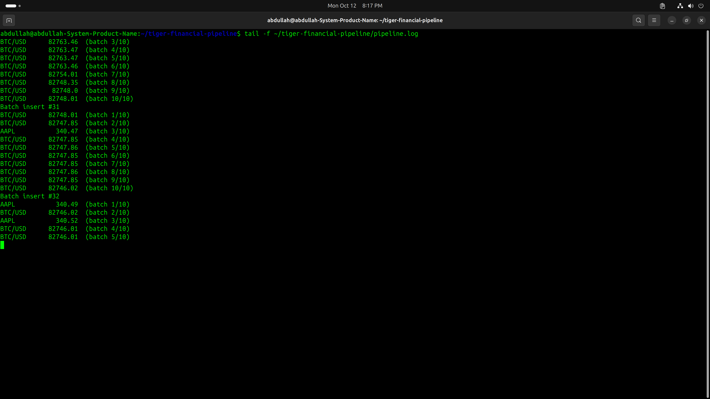
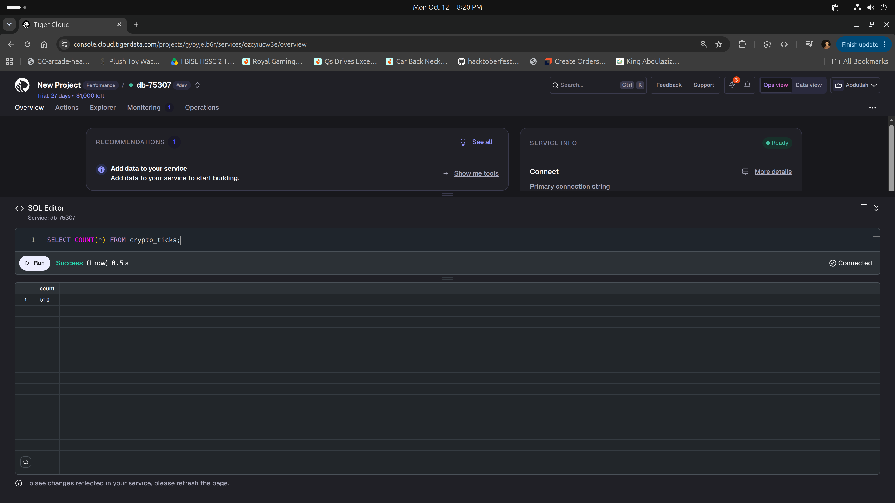
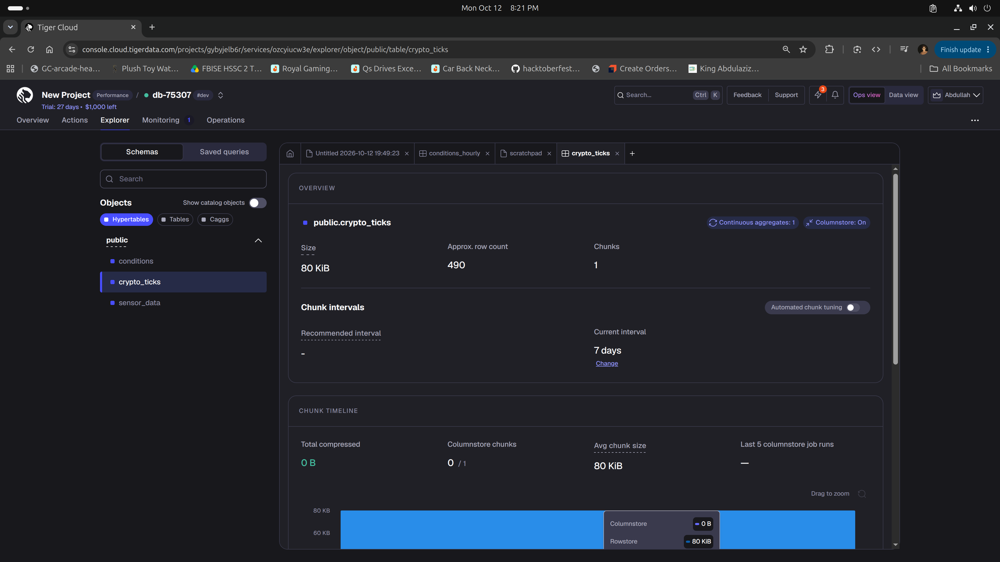
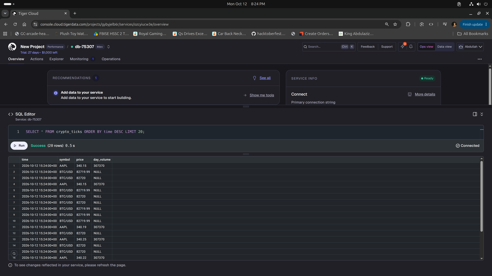
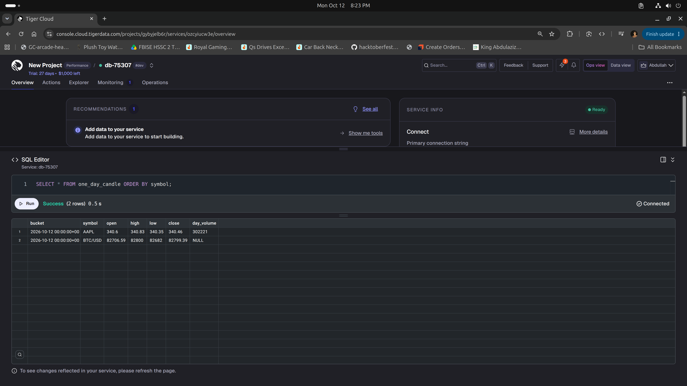

# Real-time market data pipeline on Tiger Cloud

Streams live crypto and stock prices from the [Twelve Data](https://twelvedata.com) websocket into a [Tiger Cloud](https://www.tigerdata.com) (TimescaleDB) hypertable, and rolls them up into daily OHLCV candles with a continuous aggregate.

Built for the Tiger Data challenge *Ingest real-time financial data into Tiger Cloud*, following the [official tutorial](https://www.tigerdata.com/docs/learn/tutorials/ingest-real-time-financial-data).

## How it works

```
Twelve Data websocket ──► pipeline.py ──► crypto_ticks ──► one_day_candle
 (BTC/USD, AAPL, …)       batches of N     hypertable       continuous aggregate
                          ticks, one       (columnstore,    (daily open/high/
                          INSERT each      segmented by     low/close/volume)
                                           symbol)
```

1. `pipeline.py` subscribes to the symbols and receives a `price` event per tick.
2. Ticks are buffered in memory and written with one `INSERT` per batch, which is much cheaper than one insert per row.
3. `crypto_ticks` is a hypertable, so rows are partitioned by time into chunks and older chunks are compressed into the columnstore.
4. `one_day_candle` pre-computes daily candles in the background, so dashboards query a few rows instead of every tick.

## Setup

**1. Create the schema.** Run `schema.sql` in the Tiger Console SQL editor, or:

```bash
psql "$DATABASE_URL" -f schema.sql
```

**2. Install dependencies.**

```bash
python3 -m venv env
source env/bin/activate
pip install -r requirements.txt
```

**3. Configure credentials.** Copy `.env.example` to `.env` and fill in your Tiger Cloud connection string and Twelve Data API key. `.env` is git-ignored.

**4. Run the pipeline.**

```bash
python pipeline.py
```

You should see the subscription status, then ticks and batch inserts:

```
Subscribed: ['AAPL', 'BTC/USD'] | failed: [{'symbol': 'ETH/USD'}, {'symbol': 'MSFT'}]
BTC/USD      82778.0  (batch 9/10)
BTC/USD      82778.0  (batch 10/10)
Batch insert #58
```

The Twelve Data free plan streams a limited set of symbols. Here BTC/USD and AAPL were accepted.

## Querying

Latest ticks:

```sql
SELECT * FROM crypto_ticks ORDER BY time DESC LIMIT 20;
```

Daily candles (the refresh policy skips the current day; refresh it manually to see today's candle):

```sql
CALL refresh_continuous_aggregate('one_day_candle', NULL, NULL);
SELECT * FROM one_day_candle ORDER BY bucket, symbol;
```

## Screenshots

| | |
|---|---|
| Pipeline streaming and batch-inserting |  |
| Row count growing in real time (430 → 450 → 510) |  |
| `crypto_ticks` hypertable in Tiger Console |  |
| Latest ticks in the database |  |
| Daily OHLCV candles from the continuous aggregate |  |

All screenshots are in [`screenshots/`](screenshots/).

## Configuration

| Variable | Required | Default | Description |
|---|---|---|---|
| `DATABASE_URL` | yes | | Tiger Cloud connection string |
| `TWELVEDATA_API_KEY` | yes | | Twelve Data API key |
| `SYMBOLS` | no | `BTC/USD,ETH/USD,MSFT,AAPL` | Comma-separated symbols |
| `MAX_BATCH_SIZE` | no | `10` | Ticks per insert (the tutorial uses 100) |
